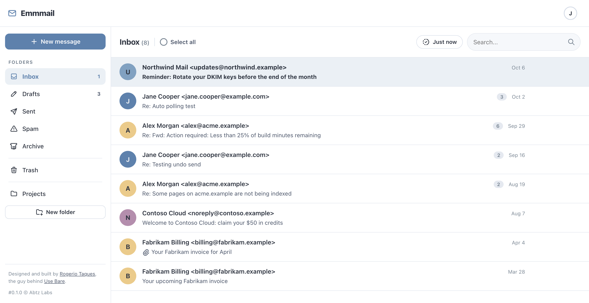

# Emmmail



A single-file, self-hosted webmail client built with PHP and SQLite.

No frameworks. No Composer. No build tools. One file, one database, done.

## Concept

Emmmail takes the opposite approach to bloated web mail clients: drop one PHP
file on any server running PHP 8+ and you have a functional email client with
IMAP/SMTP support, compose/send, search, and a Gmail-inspired interface.

The entire application — backend logic, markup, CSS, and JavaScript — lives in a
single `index.php`. The data lives in a single SQLite file created on first use.
That's the whole stack.

## Features

- IMAP and SMTP over the PHP `imap` extension and raw stream sockets
- Login with credentials validated directly against the mail server
- Provider presets (Gmail, Yahoo, Outlook, Migadu, iCloud) or a custom
  IMAP/SMTP server configuration
- Inbox, folder, and single-message (read) views with pagination
- Inbox sorted by received time (newest first)
- Folders ordered sensibly: Inbox, Drafts, Sent, Spam, Archive | Trash | others
- Compose, send (SMTP), reply, reply all, and forward, with attachments
- Markdown composer that formats as you type (see [Composer](#composer)); the
  recipient gets HTML, and the Markdown source is the plain-text part
- Cc and Bcc (Bcc travels in the SMTP envelope only; it is recorded solely on
  the copy filed in Sent)
- Save drafts, and reopen one in the composer to continue it
- Create and delete folders from the sidebar (Inbox, Drafts, Sent, Spam and
  Trash are protected)
- First-access onboarding maps the system roles to your real folder names: the
  app auto-detects Sent/Drafts/Spam/Trash/Archive from your IMAP server and
  opens a pre-filled dialog the first time you log in (dismissible, no dead end)
- Attach inline/uploaded files with size limits
- Move to Trash, restore, and empty Trash or Spam (permanent delete)
- Move a message into any folder
- Mark as spam (moves to the Junk mailbox; never deletes)
- Mark as read / unread
- Bulk selection and actions on the list view: tick rows, or select-all, then
  mark them read or unread, move them to any folder, or delete them. The
  actions post **one** request for the whole batch (up to 200 messages, and a
  handful of IMAP commands total rather than a few per message) and the rows are
  patched optimistically. A refused batch restores every row, the list count and
  the sidebar badge. `x` or Space picks the row under the keyboard cursor. The bar
  sits in the mailbox header, so it does not push the list down. On a touch
  screen, tap a sender's avatar to start a selection. A background
   poll does not reload the list while rows are picked, so a selection is never
   thrown away mid-batch
- Conversations: replies group into one row, with a count, and open as a
  thread. A reply you filed in Sent joins its Inbox conversation. See
  [Conversations](#conversations)
- Unread counters in the sidebar (Drafts shows how many drafts are waiting; Sent,
  Trash and Archive show none). Other folders refresh with one STATUS each, at
  most once a minute, during the background sync
- Unread Inbox count in the tab title, `(3) Inbox — Emmmail`, and no prefix at
  zero
- A background poll on every signed-in page, not only the folder listings: it
  syncs the Inbox, and the open folder too when you are looking at one. Once a
  minute, which is not a setting. New mail refreshes the open
  list only when you are not in the middle of something; otherwise it waits for
  a later tick. A tab you have not touched for two hours stops asking, and the
  next click or keystroke starts it again
- Optional browser notifications (Settings → Notifications), per browser and off
  by default: a count of new Inbox messages and nothing else, only while the tab
  is hidden or the window is not focused, replaced rather than stacked, and
  cleared when you come back. Desktop browsers only, and best effort — see
  [Notifications](#notifications)
- Remote images blocked by default, with a per-message reveal and a trusted-sender
  list (exact addresses). Covers ``, `background=` and CSS `url()`
- Every click that costs a round trip says so at once: opening a message spins its
  row, and a reader action (Back, Reply, Forward, Unread, Move, Spam, Delete),
  a search, the server-side search offer, or Send/Save draft in the composer spins
  its own control while a progress bar runs in the top bar
- Search across a folder (local cache first, then IMAP)
- Contacts auto-populated from recipients, with autocomplete
- Per-account settings (messages per page, display name, signature, automatic check,
  undo send, remote images, protected-folder map)
- Session-based authentication with IP binding and rate-limit on logins;
  the login page remembers the last email used and the mail-server settings
  (the preset, or your own IMAP/SMTP fields), focuses the field you still
  need to fill, and spins the Sign in button while it works
- Floating toast notifications (success/error) that never shift the layout
  and never sit translucent over the message: server flashes, login errors
  and refused actions all arrive as fixed toasts that fade out on their own
- HTML sanitization for safe message rendering
- CSRF protection, CSP, and hardened session settings
- Embedded (offline) icon set — no external requests

## Composer

You write in Markdown. The composer formats the text as you type, with no
toolbar and no external library. It sends the message as HTML, with the Markdown
source as the plain-text part. With JavaScript off, you get a plain textarea and
the same Markdown is rendered on send. "Supports simplified Markdown syntax",
above the buttons, opens the same list of options in a modal.

| Type at the start of a line | Result |
|---|---|
| `# ` … `###### ` | Heading 1 to 6 |
| `- `, `* ` or `• ` | Bullet list |
| `1. ` | Numbered list |
| `> ` | Quote (quotes nest: `> > `) |
| ```` ``` ```` + space | Code block (Enter on an empty last line leaves it) |
| `---`, `***` or `___` + Enter | Horizontal rule |

| Type anywhere | Result |
|---|---|
| `**bold**` | **bold** |
| `*italic*` or `_italic_` | *italic* |
| `~~strike~~` | ~~strike~~ |
| `` `code` `` | `code` |
| `[text](https://…)` | Link (`http`, `https` and `mailto` only) |
| `` | Remote image (`https` only) |
| a bare `https://…` | Link |

- ⌘B / Ctrl+B and ⌘I / Ctrl+I toggle bold and italic.
- Backspace right after a line-start rule gives back the characters you typed.
  Undo (⌘Z) also works: it takes two steps.
- One Enter starts a new line; an empty line separates paragraphs.
- Ordinary text stays as it is: `snake_case`, `2 * 3`, `#hashtag`, `~5 min` and
  `1986. was a year` are not formatted. A backslash makes a character literal
  (`\*`).
- In a reply or a forward, the original message is quoted as text. Its own
  Markdown, link labels and images are never rendered, so a quoted image
  cannot load when you click Reply.

### Limitations

These are decisions for this version. Each one has a regression test (group
`markdown v1 limitations`).

1. Lists are flat. An indented item joins the same list at the same level.
2. `-- `, `** ` and `•• ` are not nested-list markers. They stay as text.
3. Tab is not captured. It moves the focus out of the composer.
4. Raw HTML is not rendered. `<b>x</b>` is sent as that text.
5. No tables, task lists or footnotes.
6. Images must be `https` remote URLs. You cannot upload or embed an image in
   the body; attach it instead. Many mail clients block remote images by default.
7. Paste and drop insert plain text. Pasted Markdown is not formatted.
8. No link dialog (⌘K). ⌘U does nothing, because Markdown has no underline.
9. There is no setting to turn Markdown off.
10. If the browser restores a form after a reload, the composer shows the
    server's copy of the message, not the restored text.

The composer was verified in Chromium. Safari, Firefox and mobile keyboards
(iOS Smart Punctuation, Android composition) need a manual check.

## Notifications

The tab title always carries the unread Inbox count. Browser notifications are
opt-in, per browser, and switched on from Settings → Notifications (outside the
settings form, because the button acts at once and that form only saves on
Save). The flag lives in this browser's `localStorage`; nothing about it is sent
to the server, so each browser and each device decides for itself.

When it is on and new mail reaches the Inbox, the browser says how many messages
arrived, and only while the tab is hidden or the window is not focused — a
notification for a tab you are looking at is noise. Clicking it focuses the tab
and clears the count. The banner carries a fixed tag, so a second tab or a
second poll replaces it instead of stacking a queue.

This is a poll, not a push service, and it is best effort:

- **The tab must be open.** There is no service worker and no Web Push, so a
  closed tab knows nothing.
- **Desktop browsers only.** iOS Safari needs an installed app (`Add to Home
  Screen`) before `Notification` exists, and the card is hidden without it.
- **Phones freeze background tabs.** iOS and Android will suspend a tab you are
  not looking at, and Safari may suspend a desktop tab too, so the poll can stop
  without warning.
- **Chrome slows hidden tabs** to roughly one timer a minute, which is also the
  interval, so the two line up.
- **A card that cannot work is not shown.** No `Notification` API, or a page
  served over plain HTTP, and the card is removed. If the browser grants
  permission and then refuses to build a notification (Android Chrome does), the
  flag is turned back off and the card says so.
- **Two hours idle stops the poll**, so a forgotten window does not hold your
  session (and the mail password in it) open. Click or type and it starts again.
- **There is no sound.** The operating system plays its own notification sound,
  and a sound from a web page is not something a browser lets us control.

## Conversations

A conversation's root is the first `References` message-id, else `In-Reply-To`, else the
message's own `Message-ID`. Every cached message whose root matches groups into one row,
and the row opens at `?page=thread`. A reply you sent joins the conversation because its
copy in Sent carries the same `References`, and the send path keeps them. The reader
shows the newest 30 messages, oldest first, with the newest open.

This is a v1 with deliberate limits:

1. **A folder is grouped only when its whole message set is cached** (up to the newest
   500, the sync window). A larger folder lists flat, exactly as before, so no page ever
   mixes conversations with a live tail.
2. **Cross-folder members are whatever is cached.** Sent is kept warm by the background
   poll, so a reply you sent appears; a member of a folder that has not synced does not.
   Drafts, Trash and Junk never join a conversation.
3. **Search results are flat.** So are Drafts.
4. **A reply that carries only `In-Reply-To`** (no `References`) and answers a *middle*
   message can be grouped with its parent instead of the root. Clients that send
   `References` (Emmail, Gmail, Outlook, Apple Mail) do not show this.
5. **The reader shows the newest 30 messages** of a conversation and says how many older
   ones it left out.
6. **The upgrade rebuilds the header cache once** (schema v4), and a folder the cache
   still holds rows without a conversation key for (a cache written before the key
   existed) re-syncs itself once on the next visit.
7. A message auto-saved to Sent by the server *and* filed by Emmmail can appear twice.

## Requirements

- PHP 8.1 or later
- `ext-imap` (IMAP client)
- `ext-mbstring` (multibyte string handling)
- `ext-sodium` (encryption)
- `ext-pdo_sqlite` (SQLite database)
- `ext-dom` (HTML sanitization)
- `ext-openssl` (TLS connections)
- A web server (Apache, Nginx, or PHP's built-in server for development)

> Note: the IMAP extension was removed from PHP core at 8.4 and is now split
> out as PECL. See [Installing ext-imap](#installing-ext-imap) below.

## Installation

1. Copy `index.php` to your web root (or any directory served by PHP).
2. Make sure the directory is writable so the SQLite database can be created.
3. Open it in a browser and log in with your email account.

That's it.

### Installing ext-imap

The app requires the PHP `imap` extension.

- **macOS (Homebrew)**:
  ```
  brew tap shivammathur/extensions
  brew trust shivammathur/extensions
  brew install shivammathur/extensions/imap@8.5
  ```
- **Debian / Ubuntu** (ondrej/php PPA/DPA): `php8.4-imap` / `php8.5-imap`
- **Any PHP 8.4+** via PECL (needs `libc-client-dev`):
  ```
  pecl install imap
  ```
- **Docker** (official PHP images) with
  `mlocati/docker-php-extension-installer`:
  ```
  install-php-extensions imap
  ```
  Note: Debian *Trixie* removed `libc-client2007e`; pin the base image to
  *bookworm*.
- **Alpine**: `apk add phpXX-imap`

### Development

With [just](https://github.com/casey/just):

```
just start
```

With a custom port:

```
just start 3000
```

Run in background:

```
just start background
```

Both combined:

```
just start 3000 background
```

Stop the server:

```
just stop
```

Or run PHP's built-in server directly:

```
php -S localhost:2525 index.php
```

## Configuration

Config is via environment variables read at startup.

| Variable | Default | Purpose |
|----------|---------|---------|
| `EMMMAIL_DB_PATH` | `./emmmail.sqlite` | SQLite database location |
| `EMMMAIL_MAIL_SERVER` | (empty) | Lock the app to one host for both IMAP and SMTP (see [Locking a deployment](#locking-a-deployment)) |
| `EMMMAIL_PROVIDER` | (empty) | Lock the app to one preset: `gmail`, `yahoo`, `outlook`, `icloud` or `migadu` |
| `EMMMAIL_IMAP_HOST` | (empty) | Lock the IMAP host (needs an SMTP host too) |
| `EMMMAIL_SMTP_HOST` | (empty) | Lock the SMTP host (needs an IMAP host too) |
| `EMMMAIL_ALLOWED_DOMAINS` | (empty) | Comma-separated email domains allowed to sign in; empty = any |
| `EMMMAIL_IMAP_PORT` | `993` | Default IMAP port |
| `EMMMAIL_SMTP_PORT` | `587` | Default SMTP port |
| `EMMMAIL_IMAP_ENCRYPTION` | `ssl` | Default IMAP transport (`ssl` or `tls`) |
| `EMMMAIL_SMTP_ENCRYPTION` | `tls` | Default SMTP transport (`tls`) |
| `EMMMAIL_VERIFY_CERT` | `1` | Set `0` to skip TLS certificate verification |
| `EMMMAIL_CAFILE` | (system) | Path to a CA bundle for SMTP TLS verification |
| `EMMMAIL_ENCRYPTION_KEY` | dev default | Secret used to encrypt the session password |
| `EMMMAIL_DEBUG` | `0` | Set `1` to surface PHP errors in the response |

Logins are stored per-provider and reused as prefill for the next login.

### Locking a deployment

An operator can pin the app to one mail server, one sign-in domain, or both.

- **One server.** Set `EMMMAIL_PROVIDER` to a preset key, or set
  `EMMMAIL_IMAP_HOST` and `EMMMAIL_SMTP_HOST`. The host pair uses the
  `EMMMAIL_*_PORT` and `EMMMAIL_*_ENCRYPTION` values. `EMMMAIL_MAIL_SERVER`
  also locks: it fills whichever host is not set. While locked, the login page
  shows only email and password. Any preset or server fields in the POST are
  ignored.
- **Fails closed.** These settings are treated as a broken lock: an unknown
  provider, a provider set together with a host, or only one of the two hosts.
  The login page then shows an error, and every sign-in is refused. It never
  falls back to the dropdown.
- **Allowed domains.** `EMMMAIL_ALLOWED_DOMAINS=example.com,example.org` (commas
  or spaces, case-insensitive) limits sign-in to those domains. Subdomains do not
  count. An address from any other domain gets a friendly error. No connection
  is made to the mail server, and the attempt does not count toward the login
  rate limit. The check runs at sign-in only, so a session that already exists
  is not ended.

### Per-account settings

Each account configures its own copy of these (Settings page, stored per user):

- Messages per page (5–200)
- Display name, shown on sent mail
- Signature, inserted at the top of the compose editor, above any quoted reply
  or forward
- Protected folders: a map of the system roles (Sent, Drafts, Spam, Trash,
  Archive) to the account's actual folder names. Pre-filled from auto-detection
  until you save your own map; the first login walks you through it
- Remote images: off by default (loading one leaks that you opened the message,
  and when and from where); trusted senders always load
- Check for new mail automatically: on by default. While a page is open the app
  asks the server once a minute; turn this off and it asks only when you click
  the sync button. The interval is fixed, and a server-side throttle stops a
  burst of clicks from becoming a burst of IMAP work
- Undo send: hold sent messages for a short window so a send can be recalled

Per browser, on the same page but outside that form, because it acts at once and
never leaves the browser: notifications (see
[Notifications](#notifications)).

## Projects / Pages

Routing is `index.php?page=<page>`:

- `login`, `logout`
- `inbox`, `folder`, `read`, `thread` (one conversation)
- `compose`, `reply`, `replyAll`, `forward`, `saveDraft`
- `createFolder`, `deleteFolder`
- `delete`, `restore`, `spam` (move to the Junk mailbox)
- `move` (file into any folder), `emptyFolder` (wipe Trash or Spam only)
- `download`, `markRead`, `markUnread`
- `search`, `settings`, `contacts` (JSON autocomplete), `trustSender`
- `saveOnboarding` (JSON; first-access folder-map onboarding save)
- `sync` (JSON; background header sync, called by the client every minute, when
  the tab becomes visible, and when the sync chip is clicked)

## Database

`emmmail.sqlite` holds eight tables. The schema is versioned with SQLite's
`PRAGMA user_version` and migrated forward automatically on first open; there is
no down path.

- `settings` — per-user key/value settings
- `contacts` — auto-populated contacts (search/autocomplete)
- `search_cache` — mail search snippets for fast local search
- `login_attempts` — rate-limit bookkeeping
- `messages` — cached message **headers** (subject, sender, date, flags,
  attachment presence, a short body snippet for messages you have opened, and
  `thread_key`, the conversation root a row groups by)
- `folder_state` — per-folder sync bookkeeping (UIDVALIDITY, UIDNEXT, counts)
- `folder_list_cache` — the folder list, so the sidebar needs no IMAP round trip.
  The folder listings re-read it every 15 minutes; every other page renders the
  last copy whatever its age, because they have no way to refresh it.
- `folder_counts` — the sidebar counters (unseen and total per folder)

Message **bodies** are not stored; they are always read live from IMAP. Headers
*are* cached on disk so that list views render without contacting the server, and
opening a message stores a short plain-text snippet to make local search useful.
That cached metadata survives logout, exactly as a desktop mail client's would.

Because of this, put the database outside your document root
(`EMMMAIL_DB_PATH`) — see Security below.

## Running Tests

Every suite lives in `tests/`. Run them all:

```
just test          # or: php tests/run.php
```

`tests/run.php` requires each suite in turn, lets their output through as-is, and
prints one total at the end. Any suite also runs on its own:

```
php tests/unit.php    # pure functions + SQLite models
php tests/imap.php    # offline IMAP tests against a local stub server
php tests/smoke.php   # live server (skips without credentials)
```

| File | What it is |
|---|---|
| `tests/run.php` | Runner hub; requires every suite and prints one total |
| `tests/unit.php` | Pure functions and SQLite models |
| `tests/imap.php` | Real `MailImap` code paths against `_imap_stub.php`; asserts behaviour *and* exact IMAP round-trip counts |
| `tests/smoke.php` | Live IMAP/SMTP against your own mailbox |
| `tests/_harness.php` | Shared bootstrap and assertions (support file) |
| `tests/_imap_stub.php` | Wire-level IMAP server used by `imap.php` (support file) |

Files starting with `_` are support code, not suites. `test_suite('<name>')` gives
each suite its own throwaway SQLite database (removed on exit), so suites cannot
see each other's rows and the real `emmmail.sqlite` is never touched.

Adding a suite: create `tests/<name>.php`, start it with
`require_once __DIR__ . '/_harness.php'; test_suite('<name>');`, end it with
`summary();`, and add the name to the list in `tests/run.php`.

To run the live-server smoke tests (Tier 3), pass a preset and email. You'll be
prompted for the password (kept out of the shell history):

```
just test migadu you@example.com
```

Available presets: `gmail`, `yahoo`, `outlook`, `migadu`, `icloud`. The smoke
suite skips gracefully when no credentials are provided.

## Security

- Strict Content-Security-Policy, `X-Frame-Options: DENY`, `nosniff`,
  `strict-origin` referrer policy, and HSTS when served over HTTPS
- HTML message bodies are sanitized with an allowlist and rendered in a
  sandboxed iframe
- State-changing requests require a per-request CSRF token
- Session hardening: HTTP-only, SameSite=Strict, secure flag over HTTPS,
  strict mode, and IP binding
- Login brute-force rate limiting with a sliding window
- SMTP message-building sanitizes/encodes headers against CRLF and header
  injection
- Sensitive secrets are never echoed back after login

## Deployment

For production, serve `index.php` through Apache or Nginx with PHP-FPM. Points
to consider:

- **Database location.** By default the SQLite file (`emmmail.sqlite`) is
  created next to `index.php`. Set `EMMMAIL_DB_PATH` to place it outside the
  web root (recommended) and make sure it is within PHP's `open_basedir`,
  e.g.:

  ```bash
  # PHP built-in server (dev)
  EMMMAIL_DB_PATH=/path/to/data/emmmail.sqlite php -S localhost:2525 index.php

  # Apache
  SetEnv EMMMAIL_DB_PATH /var/data/emmmail.sqlite

  # Nginx + PHP-FPM
  fastcgi_param EMMMAIL_DB_PATH /var/data/emmmail.sqlite;
  ```

- **Encryption key.** Set `EMMMAIL_ENCRYPTION_KEY` to a long random secret. It
  is used to encrypt the account password held in the server-side session. The
  built-in default is for development only.

- **Do not deploy the `tests/` directory** to production. It is development-only.

## Contributing

Contributions are welcome. Keep these principles in mind:

1. **Single-file architecture.** All application code stays in `index.php`.
   This is a deliberate constraint.
2. **No external PHP dependencies.** No Composer, no autoloaders.
3. **Write tests.** New behavior gets tests in `tests.php`. Use TDD — failing
   tests first, then the implementation.
4. **Keep it simple.** Match the existing style; prefer straightforward code
   over abstraction.
5. **Surgical changes.** A pull request should do one thing.

### Reporting Issues

Open an issue with steps to reproduce, your PHP version, browser, and any
relevant error messages.

## License

[O'SAASy](https://osaasy.dev/). See [LICENSE](LICENSE) for details.

Designed and built by [Rogerio Taques](https://x.com/rogeriotaques).
